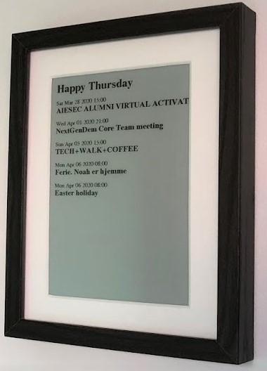
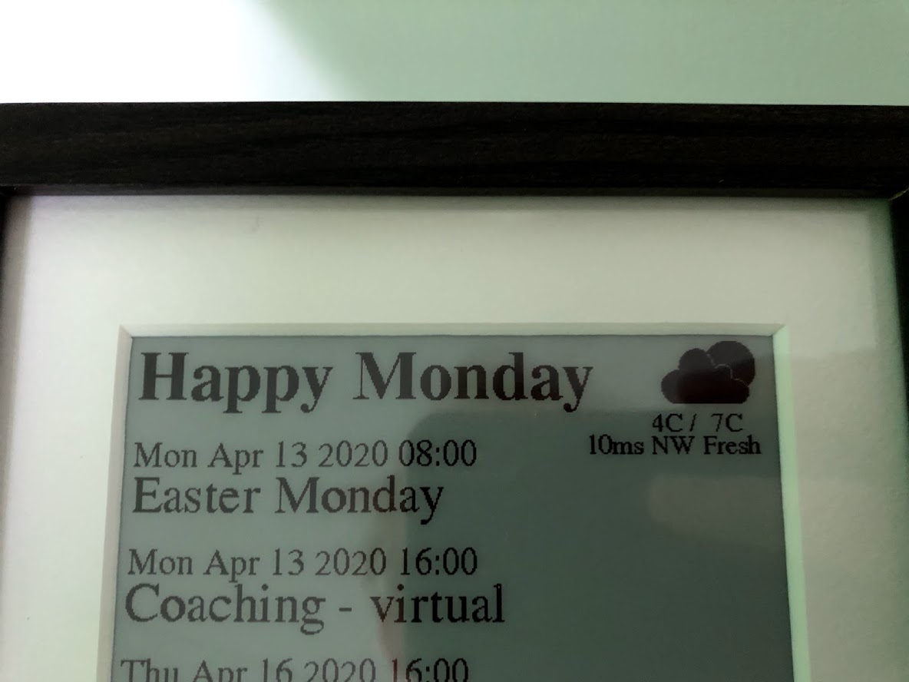
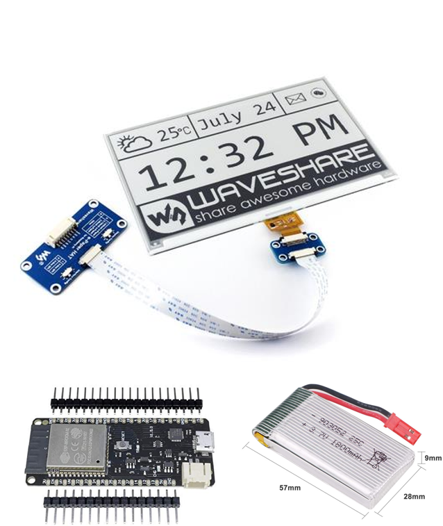
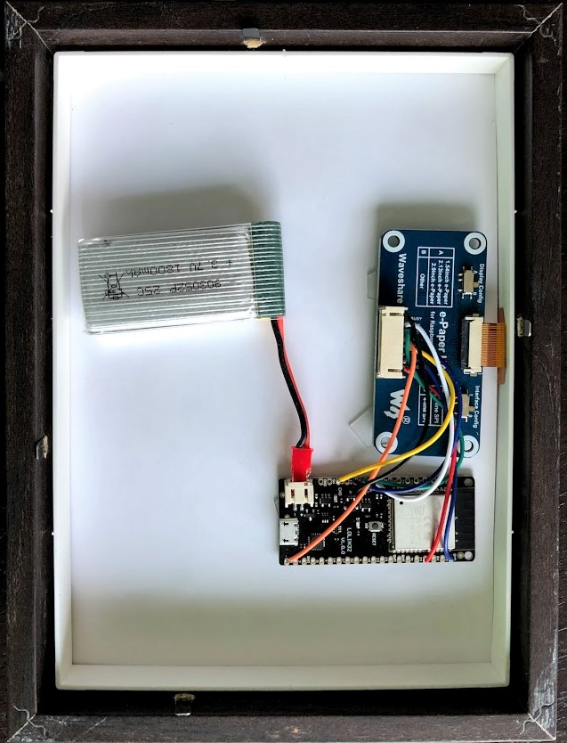

# eink-family-calendar-esp32
E-ink calendar integrating google calendar and Open-Meteo weather onto a 7.5 inch Waveshare screen based on an ESP32 LOLIN32 board

|||

For many years I have been playing with the idea of breaking the barrier between physical and digital calendars - more specifically creating a nice looking e-ink calendar that can hang in our living room/kitchen. Now the idea has materialized in a very satisfying way, and I would love to share how I made it come true.

The calendar displays the first 9 events for all selected google calendars for a specific user. In my case I have selected that of my wife, myself and our shared family calendar. Besides the calendar, I have created a mini-weather display in the corner, showing a weather icon, as well as temperature and windspeed. The weather comes from [Open-Meteo](https://open-meteo.com), which is free for non-commercial use and needs no API key (OpenWeatherMap closed the free API the calendar originally used).

The project combine a 7.5 Waveshare e-ink screen, with an ESP32 microcontroller and a LIPO battery. It is packaged in 13x18 IKEA Ribba frame. Besides Arduino code for the microcontroller, I also had to create a google script to extract the calendar entries from google.

Credits to the ESP32 E-Ink Weather Station project on Github, from which I have learned a lot when coding the project.

Components:
* Waveshare 7.5 inch E-ink Screen (800x480 version) ~76 EUR on Amazon.de (linked to the yellow C version, as I could not find the red anymore)
* LOLIN32 ESP32 ~8-9 USD on Aliexpress (I used an older version, but get the D32 or D32 Pro as it has integrated battery gauge on pin 35 - then set `batteryPin = 35` and `batteryR1 = batteryR2 = 100` in `include/credentials.h`. The default is pin 34 with a 30k/100k voltage divider)
* LIPO battery with 1800 mAH ~13 EUR on Amazon.de
* IKEA Ribba 13x18 frame ~3 EUR in IKEA

Total cost: ~100 EUR

|||

Pin-setup:

|Waveshare 7.5|LOLIN32 | 
|----------|----------|
|Vcc | 3V | 
|GND | GND | 
|DIN | 14 | 
|CLK | 13 | 
|CS | 15 | 
|DC | 27 | 
|RST | 26 | 
|BUSY | 25| 

## Setup

**1. The google script**

1. Go to [script.google.com](https://script.google.com), create a new project and paste in `googleScript.gs`.
2. Check that Project Settings has "Enable Chrome V8 runtime" ticked - Google turned off the old Rhino runtime in January 2026, and scripts still on it no longer run.
3. Optional, but recommended: under Project Settings > Script Properties, add a property named `SCRIPT_KEY` with a random text (letters and digits). Without it, anyone who knows the URL can read your calendar entries. As the key lives there and not in the code, you never need to edit `googleScript.gs` - just paste in new versions.
4. Deploy > New deployment > Web app, execute as "Me", access "Anyone". Copy the web app URL.

When you change the script later: save it (Ctrl+S) first, as a deployment uses the last saved version. Then use Deploy > Manage deployments > edit (pencil) > Version: "New version" - that keeps the same URL, so the calendar needs no change. Archive old deployments you no longer use, as they keep serving the code they were made with - including an old script without a key.

The script returns the next events from all calendars you have selected in Google Calendar, as JSON. The weekday and month names follow `calendarLanguage` in `include/credentials.h` (e.g. "de" or "da") - the script needs no changes. The display fonts only have plain ASCII characters, so letters like æ, ø, å and ä are spelled out (e.g. "Dalsgaard", "Maerz").

**2. The firmware**

The project is built with [PlatformIO](https://platformio.org). It uses the community maintained [pioarduino](https://github.com/pioarduino/platform-espressif32) platform for Arduino core 3.x, as the official PlatformIO platform stopped at Arduino core 2.0. All versions are pinned in `platformio.ini`.

The platform needs **PlatformIO Core 6.2.0 or newer** - check with `pio --version`. On Windows, `pio upgrade` can fail because `pio.exe` is in use; run `python -m pip install -U platformio` from the PlatformIO Python environment instead (`%USERPROFILE%\.platformio\penv\Scripts\python.exe`). Build from PowerShell, CMD or VS Code - the first build installs the compiler, and that installer refuses to run from Git Bash/MSYS. Then build and upload with `pio run -t upload`.

`include/credentials.h` has the settings that rarely change: timezone (default Denmark/Central Europe), the language of the weekday and month names, the hour the calendar refreshes (5 in the morning), layout, fonts and the battery measurement. If your screen or pins differ from the table above, adjust the lines under "Mapping of Waveshare ESP32 Driver Board" in `src/main.cpp`.

**3. Wifi and settings**

The first time you power on the calendar, it opens a wifi hotspot called "FamilyCalendar" and shows instructions on the screen. Connect with your phone, choose your wifi and enter:
* the web app URL of your google script (or just its deployment id)
* the script key, if you set one
* your latitude and longitude - find them using google maps

Every time the calendar is powered on or reset, the settings page is available for 5 minutes on `http://<the calendar's IP address>/param` (find the IP in your router, or on the serial monitor). Saving the settings refreshes the calendar right away. After that it sleeps and refreshes every morning. If the wifi or the calendar cannot be reached, the screen keeps the last calendar and it tries again an hour later.

For further guidance see my instructable on the project: 
https://www.instructables.com/id/E-Ink-Family-Calendar-Using-ESP32/
